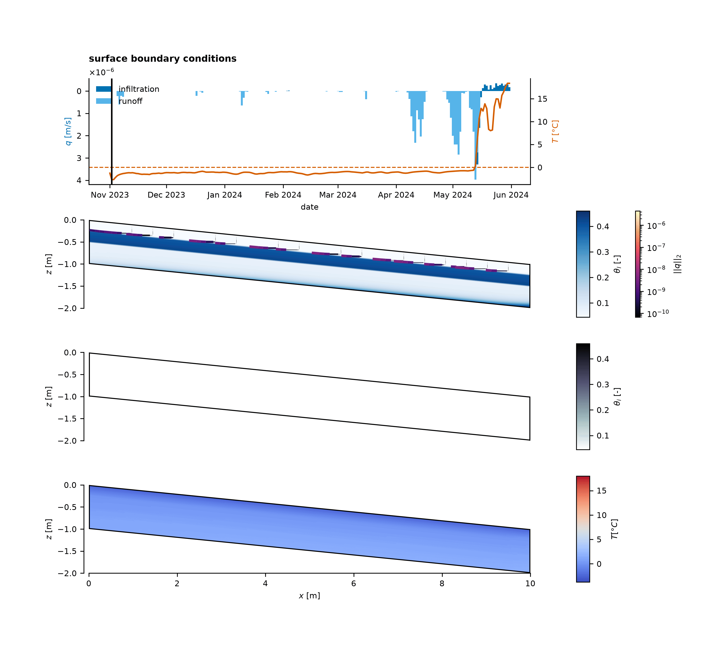

# CryoRich_AD

Author
------
Anne Hermann  
University of Tübingen  
Email: anne.hermann@uni-tuebingen.de  

Short description
-----------------

This repository contains several notebooks and utility modules used to solve the Richards equation coupled with the heat transport equation for partially frozen soils. The project is organized to keep the numerical solver and helper functions inside the `utils/` folder and the interactive work inside notebooks such as `notebooks/idealized/Idealized_cap.ipynb`.



*ERA5-Land driven simulation (November 2023 to June 2024) with the capillary bundle model (created with `notebooks/creating_figures/create_animation.ipynb`).*

Repository structure
--------------------

- `figures/` - contains all published figures (except the overview figure created with Affinity Designer).
- `input/` - all input data of the simulations:
  - `era5_land_data/` - notebooks to download the ERA5-Land data and to derive the forcing (temperature and q_inf) for the spinup and the ERA5-Land simulations, stored under `Sweden/`.
  - `idealized/` - `create_idealized_data.ipynb` creates the idealized forcing (tanh freeze-thaw ramp of the surface temperature and constant q_inf) and saves it as `idealized_forcing.pkl`.
  - `interpolation/` - interpolations are saved here as pickle files (due to their large size, they cannot be pushed to GitHub; use `notebooks/creating_figures/02compare_param.ipynb` to recreate them).
- `notebooks/` - all Jupyter notebooks are stored here:
  - `creating_figures/` - contains the notebooks used for creating the figures stored under `figures/` (including the supplementary figure) and the animation stored under `docu/Figures/`.
  - `idealized/` - contains 5 notebooks (one for each parameterization) that were used to create the idealized simulations.
  - `simulation/` - contains 5 notebooks (one for each parameterization) that were used to create the ERA5-Land simulations.
  - `spinup/` - contains 5 notebooks (one for each parameterization) that were used to create the spinup simulations.
  - `supplementary/` - contains the notebook for running the synthetic case simulated for the supplementary material.
- `utils/` - Python package with helper modules (If you modify modules under `utils/`, make sure to restart the notebook kernel):
  - `geometry.py` - main file containing the definition of the `Geom()` class used for simulations.
  - `parameter_interpolation.py` - interpolation of hydraulic parameterizations along temperature and capillary head.
  - `parse_permafoam_output.py` - contains a helper function converting permaFoam output to a pickle file.
  - `petrophysic.py` - petrophysical relations (e.g. water retention, frozen fraction).
  - `petrophysics_capillaryBundles.py` - petrophysical relations for the capillary bundle model.
  - `plotting_utils.py` - Python functions that were used to create the figures for publication.
  - `volbal.py` - balance equation helper functions.
  - `volbal_validation.py` - balance equation helper functions used for the synthetic case of the supplementary material. They need to be redefined because the BCs differ from the ones in `volbal.py`.
  - `__init__.py` - package initializer.
- `docu/` - documentation folder containing the mathematical theory guide and figures. This folder will be further developed to include code documentation.

Quick start
-----------

Create a Conda environment from the provided `environment.yml` file (recommended):

```bash
# from the repository root
conda env create -f environment.yml
conda activate cryorich_AD
```
By default, JAX is installed for CPU use. For GPU support, see the JAX installation guide: https://github.com/google/jax#installation

Parameterizations
-----------------

Five parameterizations of the hydraulic properties of partially frozen soil are compared. The table maps the names used in the code to the labels used in the publication:

| Label | Description | Name in code (`<param>`) |
|-------|-------------|--------------------------|
| (A) | drying assumption | `drying` |
| (B) | drying assumption with impedance factor Ω = 10 | `drying_omega10` |
| (C) | impedance factor Ω = 10 | `imp10` |
| (D) | impedance factor Ω = 50 | `imp50` |
| (E) | capillary bundle model | `cap` |

The same name is used for the `parametrization` variable, the notebook names and all interpolation and output files, e.g. `notebooks/spinup/0Spinup_imp10.ipynb` → `output/spinup/spinup_imp10.pkl`.

Steps to reproduce
------------------

To rerun the simulations of the publication, run the notebooks in the following order (`<param>` stands for one of the five parameterizations):

0. Forcing:
   - ERA5-Land forcing *(optional, the forcings are already included under `input/era5_land_data/Sweden/` named `sim_2312_2405.pkl` and `spinup_2308_2311.pkl`)*:
     - `input/era5_land_data/download_data.ipynb` downloads ERA5-Land data ([doi:10.24381/cds.e2161bac](https://doi.org/10.24381/cds.e2161bac)). Requests are only possible per month, so the notebook is run once per month by changing `year` and `month`. Two requests are needed per month:
       - skin temperature, snowfall, snowmelt, evaporation from bare soil and total precipitation → saved as `YY_MM.nc`
       - skin temperature, 2 m temperature and soil temperature level 1 → saved as `T_YY_MM.nc`
     - The download assigns a random file name to each download. The files were renamed by hand to the scheme above (e.g. `23_05.nc`, `T_23_05.nc`) and moved to `input/era5_land_data/Sweden/`.
     - `input/era5_land_data/creat_sim_data.ipynb` → `input/era5_land_data/Sweden/spinup_2308_2311.pkl` and `sim_2312_2405.pkl`
   - Idealized forcing *(required, the file is not included in the repository)*:
     - `input/idealized/create_idealized_data.ipynb` → `input/idealized/idealized_forcing.pkl`
1. Interpolation of the hydraulic parameters:
   - `notebooks/creating_figures/02compare_param.ipynb` → `input/interpolation/interpolation_<param>.pkl` (set `param` in the notebook), also creates `figures/theory/`
   - ~9 GB per file, ~47 GB in total
2. Spinup:
   - `notebooks/spinup/0Spinup_<param>.ipynb` → `output/spinup/spinup_<param>.pkl`
   - the spinup output is used as the initial condition for both the ERA5 and the idealized simulations
3. Simulations:
   - `notebooks/simulation/1Simulate_<param>.ipynb` → `output/simulation/simulation_<param>.pkl`
   - `notebooks/idealized/Idealized_<param>.ipynb` (reads `input/idealized/idealized_forcing.pkl`) → `output/idealized/<param>.pkl`
4. Figures (`notebooks/creating_figures/`):
   - `03domain_plot.ipynb` → `figures/method/domain.png`
   - `04forcing_plot.ipynb` → `figures/method/spin_sim_ideal.png` (forcing of the spinup, ERA5-Land and idealized simulations)
   - `06visualize_results.ipynb` → `figures/results/idealized/` and `figures/results/simulation/`
   - `create_animation.ipynb` → `docu/Figures/<param>.gif`
5. Supplementary material:
   - `notebooks/supplementary/synthetic_case.ipynb` → `output/supplementary/`
   - `notebooks/creating_figures/S1_create_supplementary_plots.ipynb` → `figures/supplementary/comparison_permaFoam.png`
   - the synthetic case is compared to a permaFoam simulation conducted in OpenFOAM, whose case folder is stored under `output/supplementary/permaFoam/`

Documentation
-------------

The `docu/` folder contains a mathematical theory guide (derivations and explanations), starting at [docu/Theory_Guide/00_Overview.md](docu/Theory_Guide/00_Overview.md). The files were created with the use of generative AI, namely Claude (Anthropic). After using this tool/service, the author(s) reviewed and edited the content as needed and take(s) full responsibility for the content of the files containing under the docu folder.
