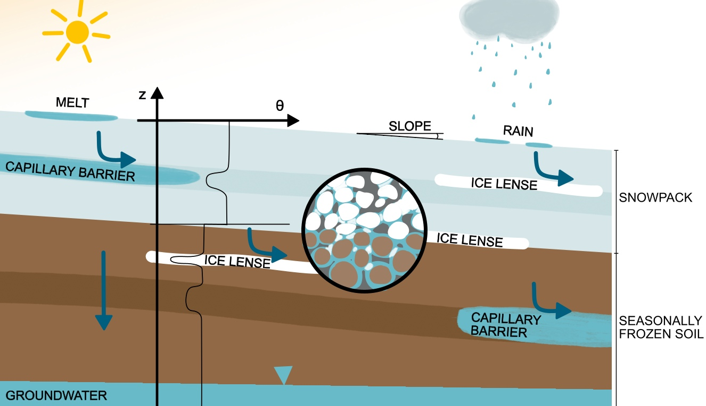

# Numerical simulation of frozen soil hydrology
## 1. Conceptual Overview
    

Variables of interest: temperature ($T$) and capillary head ($h_c$)
## 2. Governing equations
**Richard's equation** for water flux in the unsaturated zone:
  
$$\frac{\partial \theta_l}{\partial t}-\nabla \cdot (k_{rel}K_s\nabla(h_c+z))=0\tag{RE}$$

[02 Explanations to the Richard's Equation](02%20Explanations%20to%20the%20Richard's%20Equation.md)

[02.1 Overview Hydraulic Parameters](02.1%20Overview%20Hydraulic%20Parameters.md)

**Heat transport equation** for the temperature distribution [1]:  

$$\frac{\partial}{\partial t} \left( C_{eq}T + \rho_i H_f \theta_i \right)+ \nabla \cdot \left(\mathbf{q} C_\ell T \right)- \nabla \cdot \left( \lambda_{eq}(h_m) \nabla T \right) = 0 \tag{HT}$$

[03 Explanations to the Heat Transport equation](03%20Explanations%20to%20the%20Heat%20Transport%20equation.md)

## 3. Numerical Solver (Finite Volume Methods)

For the formulation of the Residuums functions see: 
[04 Finite-Volume Method](04%20Finite-Volume%20Method.md)
[05 FVM - Heat Transport](05%20FVM%20-%20Heat%20Transport.md)

Coupled Jacobian
  
$$
J = \begin{pmatrix}\frac{\partial R_h}{\partial h} \frac{\partial R_h}{\partial T}\\\ \frac{\partial R_T}{\partial h} \frac{\partial R_T}{\partial T}\end{pmatrix}
$$
  
The vector of unknowns is then $U=(h,T)^T$ and the r.h.s. vector $R=(R_h,R_T)^T$.
The Newton-Raphson algorithm then solves:
  
$$
J\Delta U=-R
$$

## 4. Model Validation 
## 4.1. Analytical Solution
[2]
## 4.2. Laboratory Experiments

---
[1]

A. A. Mohammed, B. L. Kurylyk, E. E. Cey, and M. Hayashi, “Snowmelt Infiltration and Macropore Flow in Frozen Soils: Overview, Knowledge Gaps, and a Conceptual Framework,” _Vadose Zone Journal_, vol. 17, no. 1, p. 180084, 2018, doi: [10.2136/vzj2018.04.0084](https://doi.org/10.2136/vzj2018.04.0084).

[2]

J. M. McKenzie, C. I. Voss, and D. I. Siegel, “Groundwater flow with energy transport and water–ice phase change: Numerical simulations, benchmarks, and application to freezing in peat bogs,” _Advances in Water Resources_, vol. 30, no. 4, pp. 966–983, Apr. 2007, doi: [10.1016/j.advwatres.2006.08.008](https://doi.org/10.1016/j.advwatres.2006.08.008).