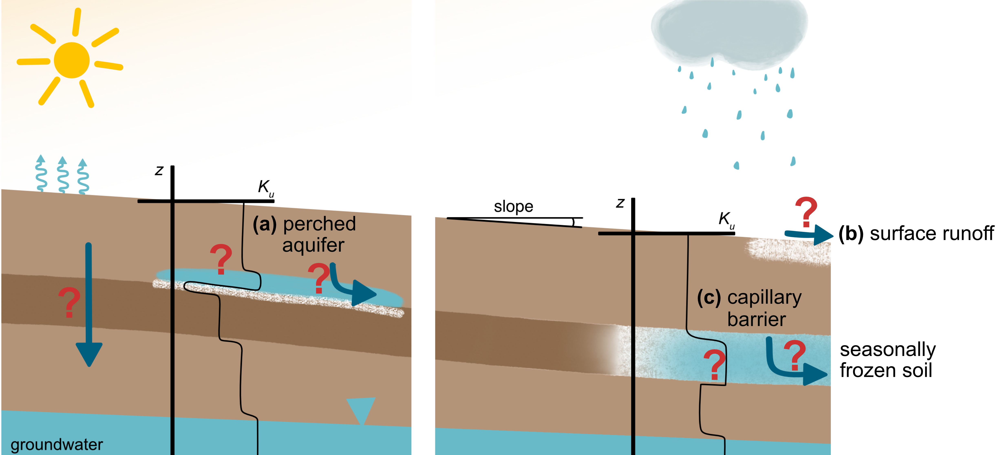

# Numerical simulation of frozen soil hydrology

The notation in this guide follows the publication *Groundwater Recharge or Runoff? Why the Hydraulic Parameterization of Frozen Soils Matters* (Hermann, Drews and Cirpka). Equation numbers of the form "paper eq. (x)" refer to that publication.

## 1. Conceptual Overview

Primary variables: pressure head of the pore water ($h_w$) and temperature ($T$).

The effective porosity $n_e$ of a partially frozen soil is the sum of the volumetric contents of ice $\theta_i$, liquid water $\theta_\ell$ and soil gas $\theta_g$ (paper eq. (1)):

$$
n_e = \theta_i + \theta_\ell + \theta_g.
$$

The total water content is $\theta_{tot}=\theta_i+\theta_\ell$.

**Sign convention:** throughout this guide the capillary head is defined by (paper eq. (7))

$$
h_c = \begin{cases}
        -h_w, &\text{if }h_w<0\\
        0, &\text{otherwise,}
    \end{cases}
$$

and the total hydraulic head is $h_{tot}=h_w+z$.

## 2. Governing equations

**Richards equation** for water flow in the unsaturated zone (paper eqs. (2) and (3)):

$$\frac{\partial \theta_{tot}}{\partial t}-\nabla \cdot \left(k_{rel}\,K_s\,\nabla(h_w+z)\right)=0\tag{RE}$$

- [02 Explanations to the Richards Equation](02%20Explanations%20to%20the%20Richards%20Equation.md)
- [02.1 Overview Hydraulic Parameters](02.1%20Overview%20Hydraulic%20Parameters.md)

**Heat transport equation** for the temperature distribution [1] (paper eq. (4)):

$$\frac{\partial}{\partial t} \left( C_{eq}T - \rho_i H_f \theta_i \right)+ \nabla \cdot \left(\mathbf{q}\, C_\ell T \right)- \nabla \cdot \left( \lambda_{eq} \nabla T \right) = 0 \tag{HT}$$

- [03 Explanations to the Heat Transport equation](03%20Explanations%20to%20the%20Heat%20Transport%20equation.md)

Both equations are coupled through the liquid and ice contents $\theta_\ell(h_c,T)$, $\theta_i(h_c,T)$ and the relative hydraulic conductivity $k_{rel}(h_c,T)$, which depend on the chosen parameterization (see [02.1](02.1%20Overview%20Hydraulic%20Parameters.md)), and through the specific discharge $\mathbf{q}$, which transports heat.

## 3. Numerical Solver (Finite Volume Method)

For the formulation of the residual functions of both equations see [04 Finite-Volume Method](04%20Finite-Volume%20Method.md).

<!-- DRAFT: section below written from geometry.py (simulate_cap_bundle, newtonRaphson_cap_bundle), please check -->

Both equations are solved fully coupled with implicit Euler time integration. In the code, the hydraulic unknown is the total head $h_{tot}=h_w+z$, from which $h_w$ and $h_c$ follow. To improve convergence when temperature variations are large (freezing and thawing), the temperature is transformed to

$$
y = \mathrm{arcsinh}\left(\frac{T}{b}\right), \qquad b = 0.1,
$$

prior to the Newton iteration and transformed back upon convergence. The vector of unknowns is thus $U=(h_{tot}, y)^T$, the residual vector is $R=(R_h,R_T)^T$ and the coupled Jacobian is

$$
J = \begin{pmatrix}\frac{\partial R_h}{\partial h_{tot}} & \frac{\partial R_h}{\partial y}\\ \frac{\partial R_T}{\partial h_{tot}} & \frac{\partial R_T}{\partial y}\end{pmatrix}.
$$

The Jacobian is computed by automatic differentiation (JAX) using its known sparsity pattern (`sparsejac`). In each Newton-Raphson iteration the sparse linear system

$$
J\Delta U=-R
$$

is solved. The update $U+\alpha\Delta U$ uses a backtracking line search (as in DuMux): starting with $\alpha=1$, $\alpha$ is halved until the residual norm no longer increases (down to $\alpha=10^{-6}$).

**Convergence:** a time step is accepted once each residual (Richards and heat transport equation, evaluated separately) is below either its absolute tolerance or its relative tolerance with respect to the residual of the first iteration.

**Adaptive time stepping:**
- If the Newton-Raphson iteration does not converge within the maximum number of iterations (or the residual becomes NaN/inf), the time step is halved and repeated.
- If it converges within the minimum number of iterations for more than two consecutive time steps, the time step is increased by a factor of 1.2, up to a prescribed maximum time step.

<!-- END DRAFT -->

## 4. Model Validation

<!-- DRAFT: please check and complete -->

The model is compared to a simulation of the same synthetic case with the permaFoam solver [2] in OpenFOAM, using the impedance-factor parameterization ($\Omega=50$) in both codes. The comparison and a mass balance check are part of the supplementary material (`notebooks/supplementary/`).

<!-- END DRAFT -->

---

[1] A. A. Mohammed, B. L. Kurylyk, E. E. Cey, and M. Hayashi, “Snowmelt Infiltration and Macropore Flow in Frozen Soils: Overview, Knowledge Gaps, and a Conceptual Framework,” _Vadose Zone Journal_, vol. 17, no. 1, p. 180084, 2018, doi: [10.2136/vzj2018.04.0084](https://doi.org/10.2136/vzj2018.04.0084).

[2] L. Orgogozo, T. Xavier, H. Oulbani, and C. Grenier, “Permafrost modelling with OpenFOAM®: New advancements of the permaFoam solver,” _Computer Physics Communications_, vol. 282, p. 108541, Jan. 2023, doi: [10.1016/j.cpc.2022.108541](https://doi.org/10.1016/j.cpc.2022.108541).
